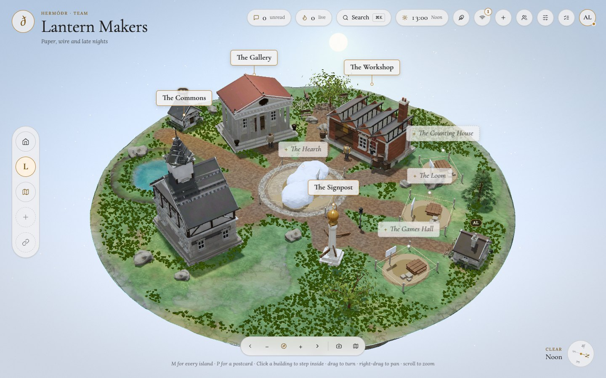
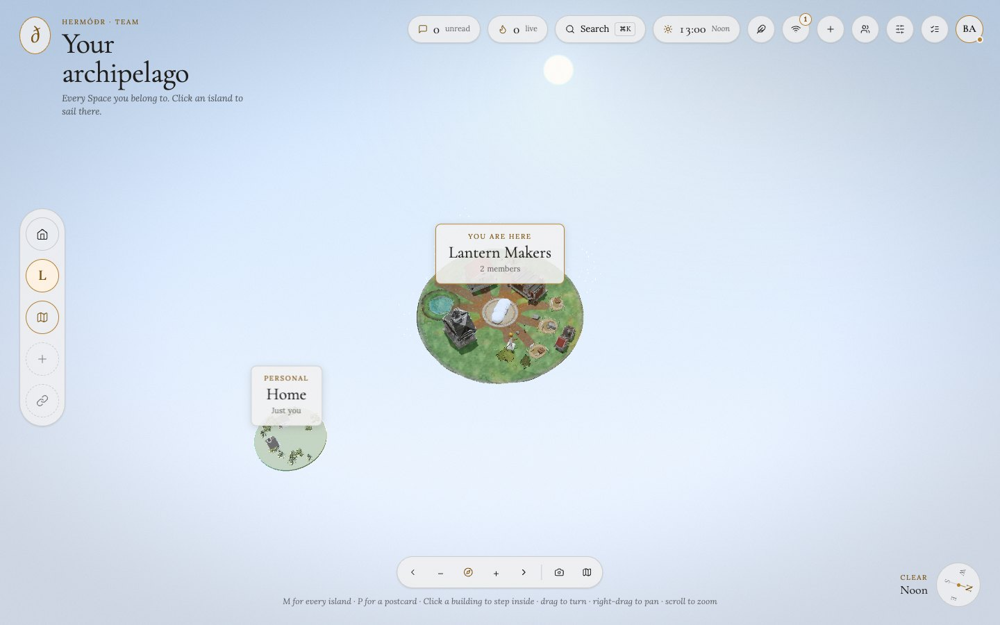

# Hermod

Hermod is a desktop app where every install is also a small peer in an encrypted mesh. Chat, share and plan with friends in private spaces. There is no central server, no account, and no telemetry.

Built with Tauri v2, Next.js and Rust (libp2p). Licensed under Apache-2.0.

Website and downloads: https://hotocoo.github.io/hermod/



| Chat | Board | All your Spaces |
|---|---|---|
|  |  |  |

Screenshots are taken headless from the real app (two local peers, content typed through the UI) with `npm run shots`.

## Install

Download the installer for your system from the [latest release](https://github.com/hotocoo/hermod/releases/latest). Early builds are not code-signed, so your system will warn you once.

- **macOS:** right-click the app, choose Open, then Open again. Or run `xattr -dr com.apple.quarantine /Applications/Hermod.app`.
- **Windows:** when SmartScreen appears, click "More info", then "Run anyway".
- **Linux:** `chmod +x Hermod_*.AppImage` and run it, or install the `.deb`.

Hermod checks GitHub for signed updates.

## How the mesh works

- Each install has its own identity key. Each space has a random key held only by its members.
- Every change is a signed, encrypted event. Members sync events directly with each other.
- Peers find each other on the local network, through public IPFS bootstrap nodes, and through addresses inside invite codes. Peers that are publicly reachable can relay encrypted traffic for others. Relays cannot read it.
- There is no public directory or search for spaces: you join one only with an invite from a member.
- Invite links look like `https://hotocoo.github.io/hermod/join#<code>`. The code is in the fragment, so it never leaves your browser, and the page opens `hermod://join/<code>` in the app.

Details: [docs/ARCHITECTURE.md](docs/ARCHITECTURE.md).

### Known limits

- Two users behind symmetric NATs may fail to connect until a reachable Hermod peer is online.
- Public IPFS bootstrap nodes and public STUN servers are third-party services.
- A removed member keeps whatever they had already synced before the removal.

## Resource sharing

With your consent, Hermod uses some CPU, bandwidth and disk to relay encrypted traffic and keep encrypted copies for spaces you are in. Defaults: 8 relay circuits, 256 KiB/s relay bandwidth, 64 MiB per circuit, 512 MiB cache for others, 64 connections. You can lower these or switch relaying off in settings. This may count against your data plan, so check your ISP terms. Full text: [legal/TERMS.md](legal/TERMS.md), [legal/PRIVACY.md](legal/PRIVACY.md).

## Build from source

Requirements: Node 22+, Rust 1.90+, and the [Tauri prerequisites](https://v2.tauri.app/start/prerequisites/) for your OS.

```bash
npm ci
npm run tauri dev      # run the app
npm run tauri build    # build installers
cargo test --workspace
npx playwright test    # UI end-to-end tests
```

## Release process

1. Bump the version in `src-tauri/tauri.conf.json` and `src-tauri/Cargo.toml`.
2. Tag and push: `git tag vX.Y.Z && git push origin vX.Y.Z`. Tags with a suffix such as `-beta.1` are published as pre-releases.
3. The `release` workflow builds macOS (Apple silicon and Intel), Linux and Windows installers, signs updater artifacts, and publishes the release with `latest.json`.

Repository secrets needed: `TAURI_SIGNING_PRIVATE_KEY`, `TAURI_SIGNING_PRIVATE_KEY_PASSWORD` (empty if the key has none). Optional for macOS signing: `APPLE_CERTIFICATE`, `APPLE_CERTIFICATE_PASSWORD`, `APPLE_SIGNING_IDENTITY`, `APPLE_ID`, `APPLE_PASSWORD`, `APPLE_TEAM_ID`.

## Legal

The legal texts are written for a personal open-source project. This text is not legal advice; have it reviewed before relying on it.

## Contributing and security

See [CONTRIBUTING.md](CONTRIBUTING.md) and [SECURITY.md](SECURITY.md).
